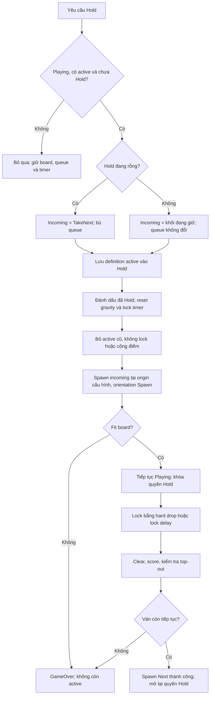
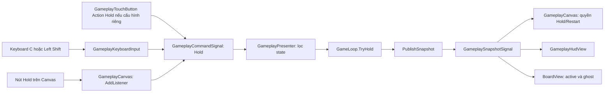
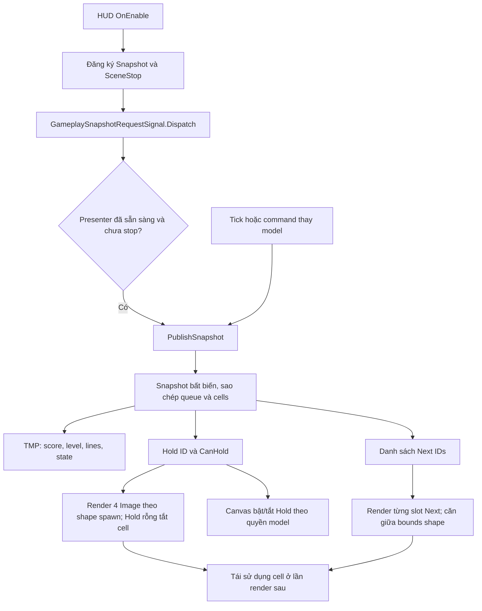
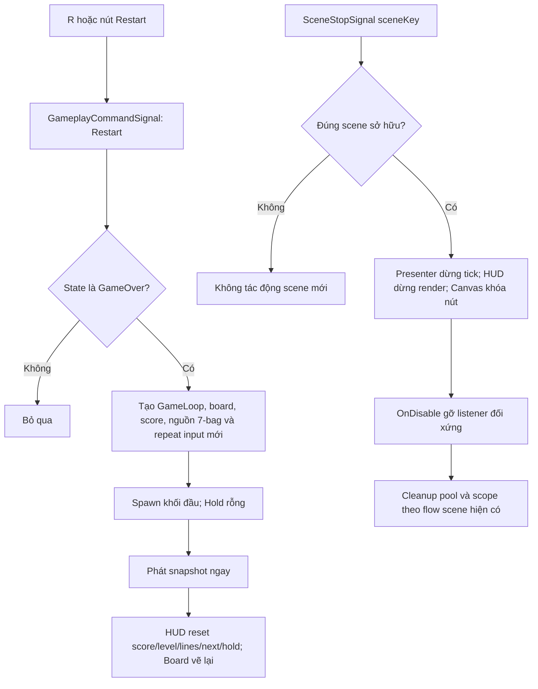
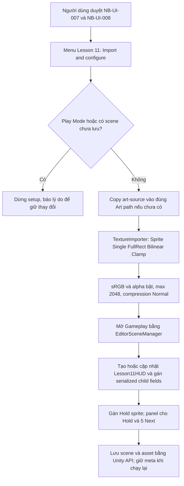
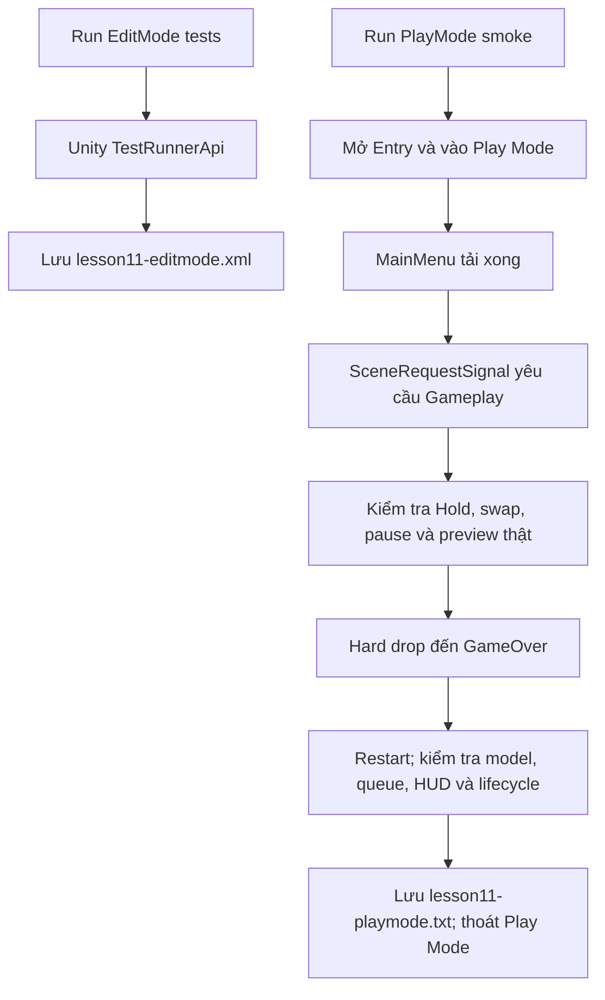

# Bài 11 — Workflow diagrams

Các sơ đồ Mermaid sau mô tả những luồng tạo hoặc thay đổi trong Bài 11. Xem bằng Markdown preview hỗ trợ Mermaid.

## 1. Hold lần đầu và swap

## 2. Input và giao tiếp view qua Signal

## 3. HUD và view bật lại

## 4. Restart và lifecycle

## 5. Import hai asset đã duyệt

## 6. Kiểm tra tự động trong Unity

