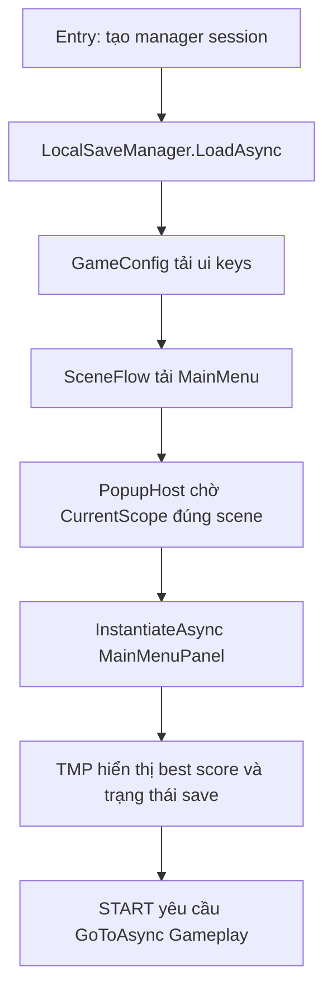
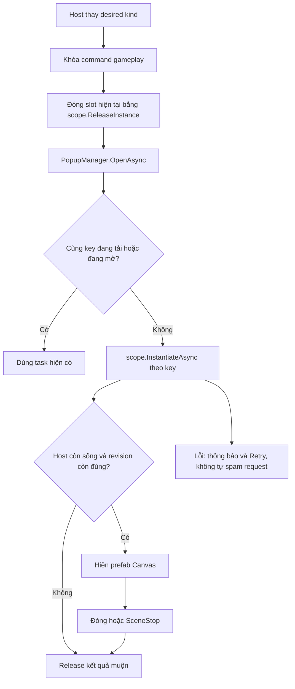
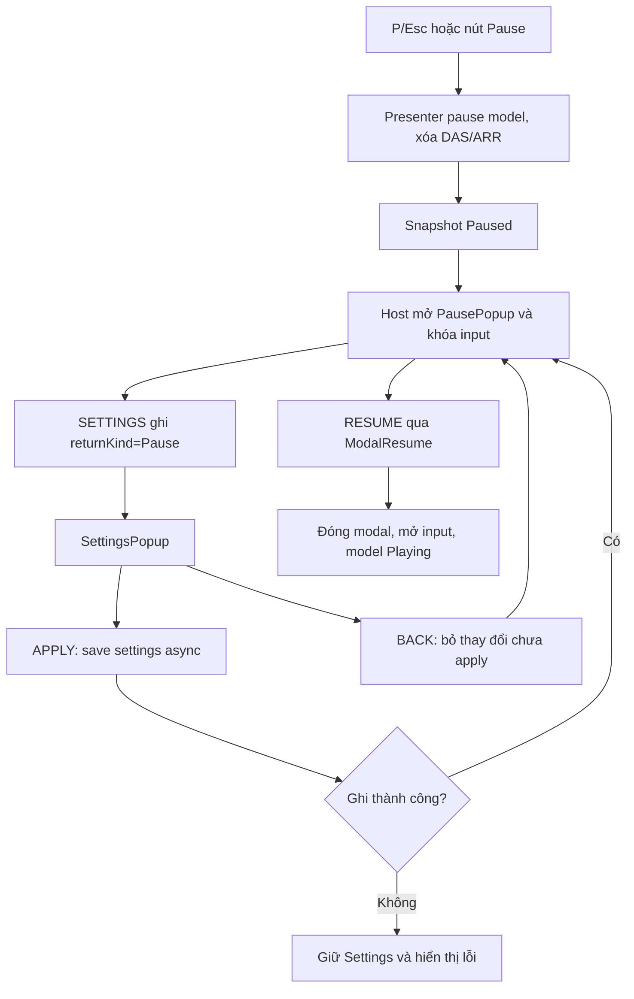
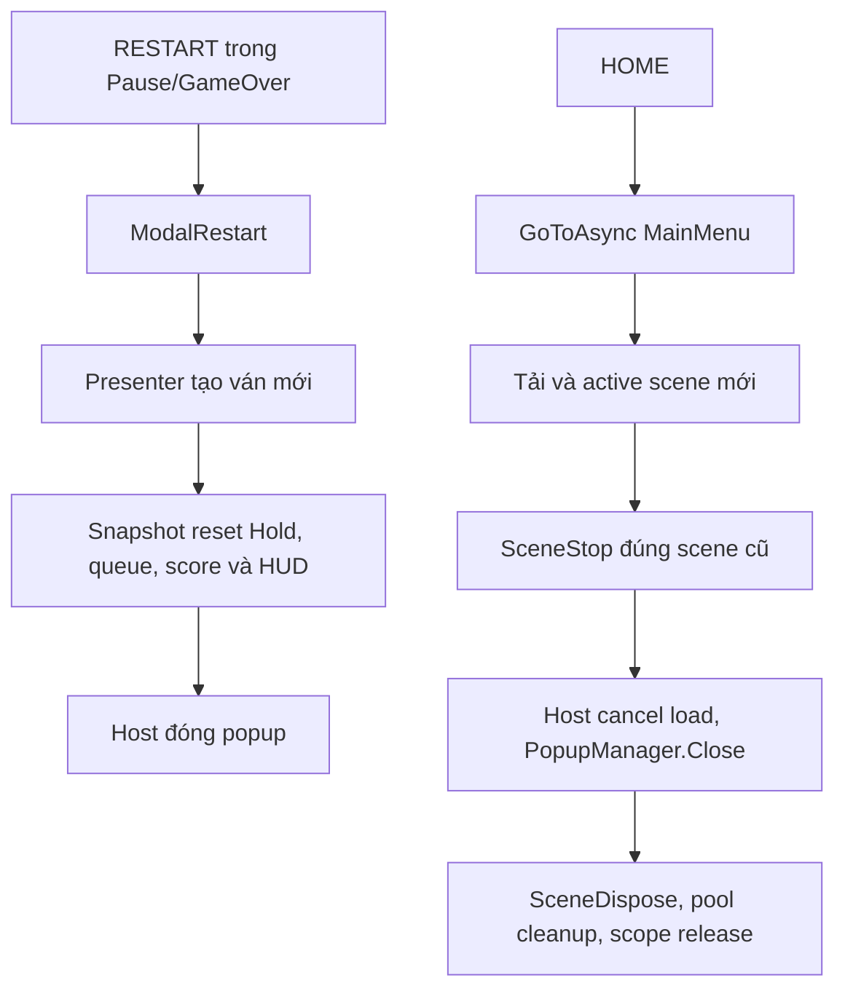
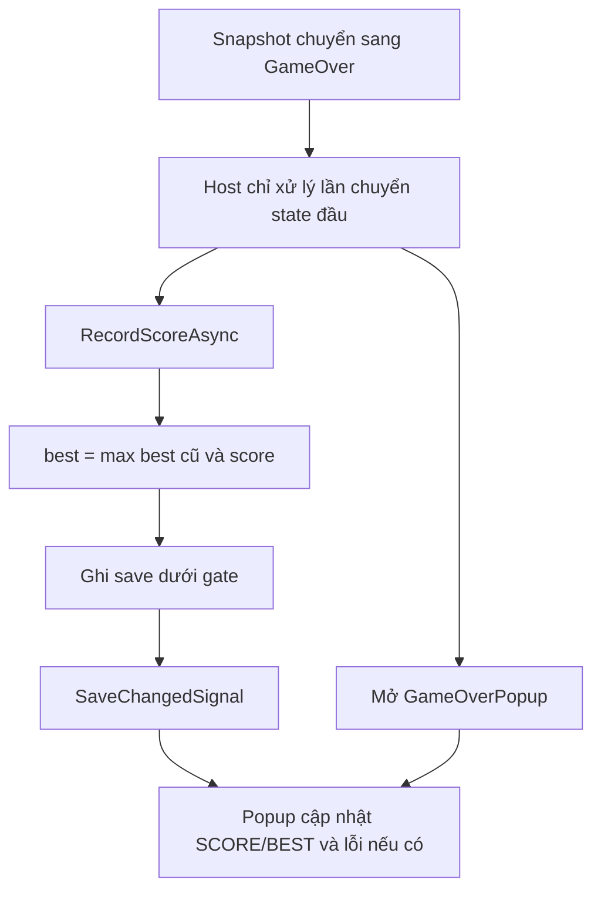
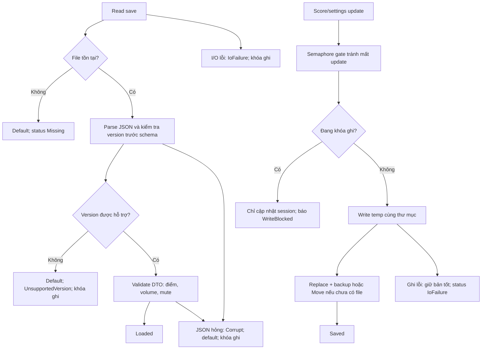

# Bài 12 — Workflow

## 1. Bootstrap và menu

## 2. Popup async và ownership

## 3. Pause, Settings, Resume

## 4. Restart, Home và cleanup

## 5. GameOver và best score

## 6. Load/save có version và fallback

