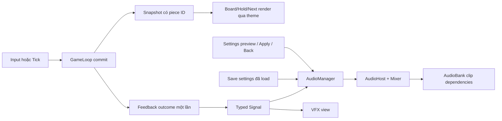

> Cập nhật 2026-11-06: người dùng đã duyệt. Đã tích hợp vào project; hướng dẫn và các khác biệt thực tế (mixer tùy chọn) xem BAI_13.md. Nội dung bên dưới giữ làm bản review ban đầu.

# Bài 13 — Asset, UI/UX và technical review

Ngày: 2026-11-06. Phạm vi theo LESSON_PLAN: mỹ thuật neon dễ đọc, phân biệt shape ngoài màu, nền tối, typography; SpriteAtlas; SFX đặt/xoay/drop/clear/gameover, nhạc và volume lưu đúng, không chớp mạnh. Đây là bàn giao asset draft và đề xuất triển khai để review, **chưa triển khai runtime hoặc import asset mới**.

## 1. Asset đã tạo

Nguồn chung: art-source/NeonBlocks/Lesson13/. Tất cả chờ duyệt.

| File trong Art/ | Kích thước | Dùng cho |
| --- | --- | --- |
| NB-GAME-002-CellI-v1.png | 1254x1254 RGBA | I cyan, vạch dọc |
| NB-GAME-002-CellO-v1.png | 1254x1254 RGBA | O vàng, ô vuông rỗng |
| NB-GAME-002-CellT-v1.png | 1254x1254 RGBA | T tím, tam giác |
| NB-GAME-002-CellJ-v1.png | 1254x1254 RGBA | J xanh lam, chấm tròn |
| NB-GAME-002-CellL-v1.png | 1254x1254 RGBA | L cam, hình thoi |
| NB-GAME-002-CellS-v1.png | 1254x1254 RGBA | S xanh lá, dấu cộng |
| NB-GAME-002-CellZ-v1.png | 1254x1254 RGBA | Z coral, dấu X |
| NB-GAME-003-GhostCell-v1.png | 1254x1254 RGBA | Viền rỗng, tâm alpha=0 |
| NB-UI-012-QuietBackground-v1.png | 941x1672 RGB | Nền portrait gần 9:16, tâm tối, ít nhiễu |

Các tile là **một ô**, không phải toàn tetromino. Bốn cell được model ghép thành shape theo orientation. Không dùng ký hiệu thay cho hình dạng thật. Tile AI có khác biệt bevel/độ lớn ký hiệu giữa mẫu; cần review ở 24/32/48 px trước khi chốt. Canvas đã sát artwork/glow; không thêm transparent padding vuông bao ngoài. RGBA mặt tile có alpha gần 1, chưa khẳng định mọi pixel nội thất opaque.

| File trong Audio/ | Thời lượng | Format / ý đồ |
| --- | --- | --- |
| NB-SFX-001-Lock-v1.wav | 0.160s | Mono; thud điện tử ngắn khi khóa khối |
| NB-SFX-002-Rotate-v1.wav | 0.105s | Mono; chirp lên khi xoay thành công |
| NB-SFX-003-Drop-v1.wav | 0.280s | Mono; sweep xuống và impact |
| NB-SFX-004-Clear-v1.wav | 0.650s | Mono; chime đi lên cho clear |
| NB-SFX-005-GameOver-v1.wav | 1.150s | Mono; motif đi xuống, phát một lần |
| NB-MUS-001-MenuLoop-v1.wav | 20s | Stereo; 96 BPM, 8 bars, synth/pad nhẹ |
| NB-MUS-002-GameplayLoop-v1.wav | 32s | Stereo; 120 BPM, 16 bars, bass/arp/pulse |

Mọi WAV là PCM 44.1kHz/16-bit. Nhạc được sáng tác/tổng hợp dạng oscillator, không phải đầu ra mô hình music AI và không dùng sample bên ngoài. Nguồn tái tạo: Sources/synthesize_audio.py. Giai điệu/hòa âm lặp có chủ đích; chất lượng cảm nhận và đường nối loop vẫn cần nghe review trên loa/tai nghe.

## 2. Asset tái sử dụng và artifact dựng trong Unity

- Giữ các nút touch, Pause, Settings/HighScore icon, Hold/Next panel và popup background hiện có; không gen bản trùng chỉ vì chuyển bài.
- Typography và logo tên game dùng TMP, không bake chữ thành PNG. Dùng font đã có trong project sau khi kiểm tra glyph và license đi kèm; chưa thêm font bên ngoài.
- Thay phần lưới raster không chuẩn của NB-UI-003 bằng grid **10x20 chính xác từ cấu hình** dựng bằng Unity UI/custom Graphic. Viền có thể dựng bằng UI hoặc dùng phần border artwork đã duyệt; không dùng toàn lưới cũ để căn model.
- Atlas, palette/theme data, AudioMixer, AudioBank prefab và TMP font asset là artifact kỹ thuật sẽ tạo trong Unity sau duyệt, không phải ảnh/âm thanh còn thiếu.
- Hiệu ứng clear dùng alpha/scale và dải sáng UI nhẹ, không cần sprite sheet VFX mới.

## 3. Palette và typography đề xuất

Màu dưới đây là token runtime/thiết kế dự kiến; imagegen không bảo đảm mọi pixel bằng đúng mã hex.
- Background #080D1C; surface #101A2E; primary text #EAF2FF; secondary #A9B8CF.
- Accent UI cyan #23DFF5 và violet #B184F5.
- Piece I/O/T/J/L/S/Z: #23DFF5 / #F6CC4A / #B184F5 / #5E92F3 / #F5A456 / #59D995 / #F0788B.
- Scale chữ trên reference 1080x1920: title 48–56, primary button 32–36, HUD value 36–42, label 26–30, thông báo 24–28.
- Không dùng chữ neon mỏng cho số liệu; màu sáng ổn định, không animation pulse liên tục. Kiểm tra glyph tiếng Việt ở thông báo save.
- Mục tiêu tương phản chữ thường >=4.5:1, chữ lớn >=3:1 là tiêu chí kiểm tra, chưa đo tương phản trên output thực.

## 4. UI/UX trong bài

| Khu vực | UI đề xuất | Hành vi UX / tiêu chí |
| --- | --- | --- |
| MainMenu | Nền tối mới, TMP tên game, Start/Settings, best score | Giữ hierarchy/nút hiện tại; nút chính nổi rõ; nhạc Menu nhẹ |
| Board | Lưới logic 10x20, tile theo loại khối | Không căn gameplay theo pixel grid raster; ô vuông và border không ăn vào playfield |
| Active | Sprite màu + ký hiệu đầy đủ, sáng nhất | Không nhấp nháy; silhouette và ký hiệu đều nhận ra |
| Settled | Cùng loại tile, giảm sáng nhẹ, alpha vẫn đủ đọc | Không đổi tất cả thành một màu; giữ danh tính sau clear/compact |
| Ghost | Viền rỗng, tint màu nhạt, không fill | Nằm sau active, khớp hard-drop; không nhầm thành settled |
| Hold/Next | Bốn tile theo shape spawn, cùng style board | Hold hết quyền giảm sáng và nút disabled; vẫn đọc được shape/ký hiệu |
| HUD | Score/Level/Lines rõ trên nền tối | Không để glow đè chữ; hierarchy giá trị > nhãn |
| Touch controls | Giữ icon đang dùng, feedback pressed/disabled rõ | Đề xuất hit area >=48dp khi quy đổi trên thiết bị; không coi 48 Canvas px là 48dp |
| Pause/Settings | Giữ modal, backdrop chặn pointer, Music/SFX/Mute | Pause không tích lũy input; Back từ Settings không resume nhầm |
| GameOver | Score/Best và Restart/Home | One-shot GameOver sound; nhạc fade xuống, không flash toàn màn |
| Lock/Rotate/Drop | SFX ngắn theo kết quả commit | Không kêu rotate khi collision làm phép xoay thất bại |
| Clear | Chime và fade nhẹ 100–180ms | Không strobe, không trắng toàn màn, không trì hoãn model clear |
| Safe area | Board và HUD layout co theo không gian | Kiểm tra 9:16, 9:19.5, 9:20; background cover, content không bị crop |

Nhạc: khi Pause giảm nhạc còn khoảng 30–40% gain đang chọn thay vì khởi động lại loop; Settings không pause UI feedback. GameOver giảm nhạc rồi one-shot; Restart/Home crossfade 300–500ms. Mute thắng mọi gain, không reset slider. Hai slider được preview khi kéo nhưng chỉ APPLY mới persist; BACK trả về giá trị đã lưu. Đây là đề xuất thay đổi UX của Settings cần review.

## 5. Technical — dữ liệu board và render

### Vấn đề hiện tại cần sửa
BoardModel đang dùng bool[,] settledCells; GameplaySnapshot chỉ có tọa độ settled. Nếu chỉ đổi sprite BoardView, các ô khóa sẽ mất piece ID và không thể giữ màu/ký hiệu.

### Thiết kế
1. Thay state chuẩn bằng PieceId?[,] hoặc enum[,] có giá trị Empty. Không giữ bool[,] song song gây hai nguồn dữ liệu.
2. CanFit/IsSettledAt chỉ hỏi Empty/non-empty, luật va chạm không đổi.
3. Lock chép ID từ ActivePiece.Definition.Id vào bốn ô; ClearFullRows compact cả ID cùng tọa độ.
4. Thêm SettledTile readonly (position, pieceId) và snapshot typed tương ứng. Giữ API tọa độ cũ khi cần tương thích test, derive từ state chuẩn.
5. BoardView chuyển RawImage placeholder sang Image sprite; mapping ID→sprite trong theme/prefab dependency. Runtime không lookup asset bằng Resources.
6. Board/ghost/preview cùng dùng mapping theme; tách brightness layer khỏi màu source, tránh tint nhân màu làm sai palette.
7. Khi ghost trùng active đang chạm đáy, ưu tiên active; ghost phía sau, không tạo double rim gây sáng quá.
8. Lưới chuẩn được dựng một lần khi kích thước thay đổi, cellSize=min(width/10,height/20), không dùng inset calibration raster cũ.
9. Pool/tái dùng cell UI, không Instantiate/Destroy mỗi snapshot; không thêm Jobs/Burst khi chưa có số đo.

## 6. Technical — sự kiện âm thanh và VFX

Không phát SFX bằng cách so snapshot mỗi frame. GameLoop tạo event/outcome bất biến sau các thao tác đã commit:
- Rotated: TryRotate thành công; không phát với khối O không đổi orientation nếu chọn không cần feedback.
- Locked: khóa thành công do gravity/lock delay.
- HardDropped: thao tác hard drop hợp lệ, chứa distance; xử lý cùng outcome lock/clear để không chồng ba impact.
- RowsCleared: clearedCount>0, một event cho batch dù xóa 4 hàng.
- GameEnded: lần chuyển Playing→GameOver, không phải mỗi snapshot GameOver.

Event queue/outcome được Presenter drain đúng một lần sau command hoặc Tick, phát GameplayFeedbackSignal typed. Bổ sung sequence/session ID để audio/VFX không phát lại khi HUD yêu cầu snapshot. Input view không phát audio trực tiếp.

Ưu tiên SFX: GameOver/Clear cao hơn Lock; HardDrop dùng Drop thay Lock trong cùng outcome. Giới hạn 6–8 voice, throttle Rotate tối thiểu khoảng 40ms; không thay đổi gameplay timing. VFX chỉ diễn giải event, không delay hoặc sửa BoardModel.

## 7. Technical — AudioManager và ownership

- AudioManager thuần C#, đăng ký qua SessionManager; quyết định track, volume, mute, voice priority.
- AudioHost MonoBehaviour là adapter phát âm thanh, chỉ quản lý AudioSources thuộc chính nó; nghe AudioPlaybackSignal typed. Không serialized tham chiếu tới view khác.
- Đề xuất AudioBank Addressable prefab root cùng tên key; chứa AudioHost, AudioSources, clip dependencies và AudioMixer references.
- Instantiate AudioBank một lần theo owner session qua AddressableManager, parent dưới SessionManager hiện có; không thêm GameObject DontDestroyOnLoad độc lập.
- Chỉ SessionManager là gốc sống xuyên scene; không tạo AudioListener mới trong AudioBank.
- Clip là dependency của prefab, không đánh Addressable riêng từng WAV khi không cần tải độc lập.
- Key AudioBank thêm vào GameConfig JSON/DTO/domain, không hardcode runtime.
- AudioMixer: Master/Music/SFX, exposed MusicVolumeDb/SfxVolumeDb. Slider linear chuyển bằng 20*log10(max(v,0.0001)); mute dùng floor -80dB.
- Load LocalSaveManager.Data trước khi phát clip đầu; không có “âm thanh bật lớn một frame rồi mới mute”.
- Settings preview và rollback qua Signal riêng; Apply tiếp tục dùng LocalSaveManager.SetSettingsAsync. Không ghi file ở mỗi slider tick.
- AudioSource spatialBlend=0, UI/gameplay 2D. Crossfade dùng thời gian không bị pause gameplay.
- Session dispose: gỡ listener, dừng Sources/crossfade trước release AudioBank instance và owner; SceneStop không dispose manager session.
- Sau switch Additive hoàn tất chỉ có một AudioListener và EventSystem. Cảnh báo trùng trong giai đoạn overlap của bài 12 cần kiểm tra riêng, không thêm listener để “sửa” âm thanh.

## 8. Technical — import và atlas

| Asset | Import đề xuất sau duyệt |
| --- | --- |
| 7 cell + ghost | Sprite Single/FullRect, PPU100, pivot Center, Bilinear, Clamp, mipmap off, alpha on; resize bản tích hợp khoảng256px/cell sau QA, giữ source1254 |
| Background | Sprite hoặc Texture UI phù hợp renderer, sRGB, Clamp, max2048, không vào atlas cell |
| Gameplay SpriteAtlas | 7 cell + ghost ổn định, padding4px, rotation off, tight packing off; kiểm tra bleed Android; atlas max2048 |
| UI atlas | Chỉ sprite UI ổn định hiện có; không trộn background lớn với control nhỏ |
| SFX WAV | Mono, Decompress On Load; PCM/ADPCM sau nghe so sánh, preload, không streaming SFX ngắn |
| Nhạc WAV | Stereo, Loop AudioSource, Vorbis quality khoảng0.7 hoặc PCM trong Editor so sánh; Streaming Android nếu phù hợp và đo trên thiết bị |
| TMP | Reuse font có license/glyph cần thiết, font material đọc rõ, không rasterize chữ |

SpriteAtlas/prefab được tạo bằng Editor API hoặc thao tác Editor sau duyệt; không sửa YAML bằng tay. Giữ đường dẫn/.meta khi thay bản asset đã tích hợp.

## 9. Nguồn, quyền và kiểm tra đã làm

- PNG: built-in image_gen, prompt gốc ở Sources/image-prompts.json; dùng bộ neon hiện có làm định hướng mô tả, không dùng ảnh tham chiếu bên ngoài.
- WAV: sáng tác/tổng hợp mới bằng oscillator sine/harmonic và score nốt trong source, không sample/track bên thứ ba, không voice hoặc nhạc có lời. Không tuyên bố quyền độc quyền đối với đầu ra AI.
- Các font/asset cũ giữ nguyên notice/license nguồn của chúng; bài này chưa thêm font tải ngoài.
- Đã xem từng output ảnh, kiểm tra dimensions/pixel format và lấy mẫu alpha center/corner. Ghost center=0; background RGB opaque; không khẳng định đã kiểm tra mọi pixel alpha.
- WAV kiểm tra header, thời lượng, peak/RMS và clipping: 0 sample clipping. Loop boundary delta khoảng0.00043 (Menu) và0.00052 (Gameplay), chưa thay thế kiểm tra nghe loop trong Unity/codec Android.
- Chưa chạy gameplay với art/audio mới, chưa đo FPS/drawcalls/memory/contrast, chưa nghiệm thu màn hình dài hoặc khả năng nhận diện không màu.

## 10. Thứ tự triển khai sau review

1. Duyệt palette, ký hiệu/độ lớn pattern, nghe 7 WAV; chốt loại feedback và UX settings preview.
2. Thay state settled và viết test ID giữ sau lock/clear/compact; regression SRS/Hold/score.
3. Theme mapping + BoardView/Image + chuẩn hóa grid + HUD preview, import/atlas sau khi duyệt.
4. Event outcome + SFX/VFX, đảm bảo không phát lặp qua snapshot hoặc lệnh thất bại.
5. AudioBank/Mixer/AudioManager/AudioHost + load saved volume, preview/apply/back/mute.
6. Setup Unity checklist, PlayMode qua nút thật và loop nhiều vòng; 9:16/màn dài/safe area.
7. Test duplicate event/voice limit, restart/home không nhân audio host, mute từ bootstrap, save lỗi không reset gain.
8. Bàn giao sáu workflow diagrams và bằng chứng thật; chỉ đánh dấu hoàn thành khi nghiệm thu, không tự làm bài14.

## Workflow đề xuất

